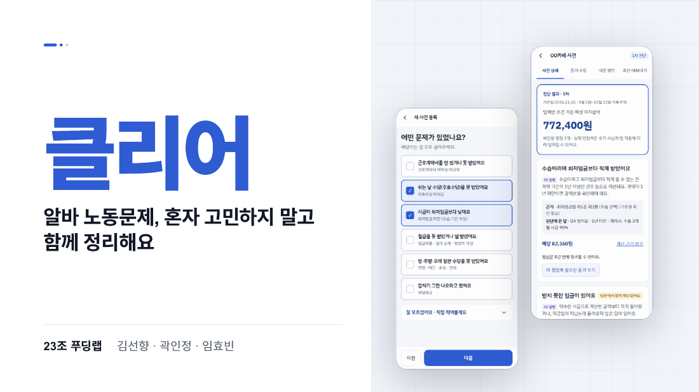

# 🚀 클리어 중간 발표자료 (11/23)
- **팀**: 푸딩랩 (23조) — 김선향 · 곽인정 · 임효빈
- **서비스**: 클리어 (Clear) — 알바 노동문제, 혼자 고민하지 말고 함께 정리해요

---

## 🖼️ 슬라이드

📎 [발표자료 PDF 보기 (22장)](https://github.com/pudding-lab-2026/capstone/blob/main/docs/클리어-중간-발표.pdf)

---

## 💡 발표 내용 요약

- **프로젝트 소개**: 아르바이트생의 근로 상황과 보유 자료를 분석해 노동 문제를 진단하고, 증거 정리부터 대응 방법 선택, 문서 초안까지 이어주는 맞춤형 대응 서비스
- **문제 상황**: 노동법 위반 피해 경험자 25.6% 중 84.2%는 대응하지 못했고 여전히 임금 문제가 해결되지 않음 (몰라서 46.7% · 복잡해서 32.8% · 무서워서 55.6%)
- **차별점**: ① 출발점이 '신청'이 아닌 '파악' ② 해결 경로를 하나로 정하지 않고 선택권은 사용자에게
- **핵심 기능 플로우**: 상황진단 → 증거안내 → 해결방법 제시 → 초안 작성
- **기능 우선순위(MoSCoW)**: Must 7개 / Should 3개 / Could 5개, Won't는 자유 대화형 상담 챗봇
- **다룰 노동법 위반 유형**: Must 1~4순위(근로계약서 미작성·미교부, 주휴수당 미지급, 최저임금 미달, 임금체불·임의 공제·일방적 삭감), Should 5~6순위, Could 7~8순위
- **기술 적용 원칙**: LLM은 법적 판단을 하지 않고(판단·계산은 규칙), AI 전송·외부 내보내기 전에는 항상 마스킹하며, 자동으로 읽은 값은 사용자가 고칠 수 있음
- **법률 정보 신뢰성**: 공식 출처에서 미리 저장 → 규칙으로 판단하고 근거 조문 연결 → 결과에 출처·기준일 표시, 법 개정 시 사람이 검토한 뒤 반영
- **향후 계획**: 에픽 9개·스토리 35개 백로그, 겨울방학 개발(1/18~2/16)을 5개 구간으로 나눠 진행
- **시스템 구조**: React + TypeScript(효빈) / Java + Spring Boot(선향) / Python FastAPI의 AI·마스킹·OCR(인정), 보안 점검(인정)

---

## ❓ 질의응답

### Q1. 사용자가 근무 시간이나 시급을 잘못 기억하거나 유리하게 부풀려 입력하면 진단 결과도 사실과 다르게 나옵니다. 입력값이 거짓이거나 부정확한 경우를 어떻게 막거나 걸러낼 계획인가요?

입력값의 진위를 서비스가 완전히 검증하기는 어렵습니다. 그래서 사용자에게 위조된 입력에 대한 책임은 본인에게 있다고 고지할 예정이고요, 또 증거 단계에서 뒷받침 자료를 요구하기 때문에 근거 없이 부풀린 값은 실제 대응에서 오히려 불리해집니다.

### Q2. 법령 정보를 다루는 서비스인데, 판단에 RAG를 쓰지 않고 규칙 기반으로 하는 이유가 무엇인가요? RAG를 사용하면 AI의 정확성이 떨어지는 것을 막을 수 있지 않을까요?

RAG는 어떤 법을 적용할지 모를 때 근거를 찾아오는 기술인데, 클리어는 유형이 정해져 있어서 어떤 유형은 어떤 조문인지가 명확해 찾을 필요가 없습니다.

또 RAG로 찾아와도 결론은 결국 LLM이 내리는데, 직접 만들어 보니 같은 질문에도 뉘앙스가 달라져 테스트 용이성이 낮았습니다.

그래서 판단과 계산은 규칙으로 하고, 한 줄만 고쳐 다시 테스트할 수 있게 했으며, AI는 사용자가 확인·수정할 수 있는 상황 해석과 초안 작성에만 씁니다.

### Q3. 일반적인 알바생들은 본인의 사업장이 5인 이상인지 미만인지 모를 텐데, 그걸 사용자의 입력에 의존하면 안 되는 거 아닌가요?

사업장명으로 보험 가입 여부를 조회하는 사이트에서, 보험에 가입된 인원수로 사업장 규모를 추정할 수 있습니다.
